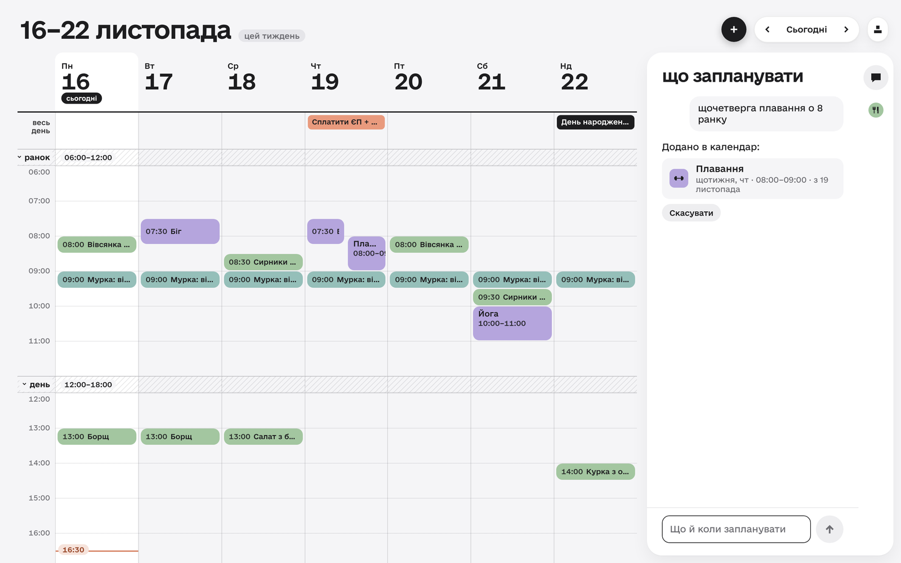
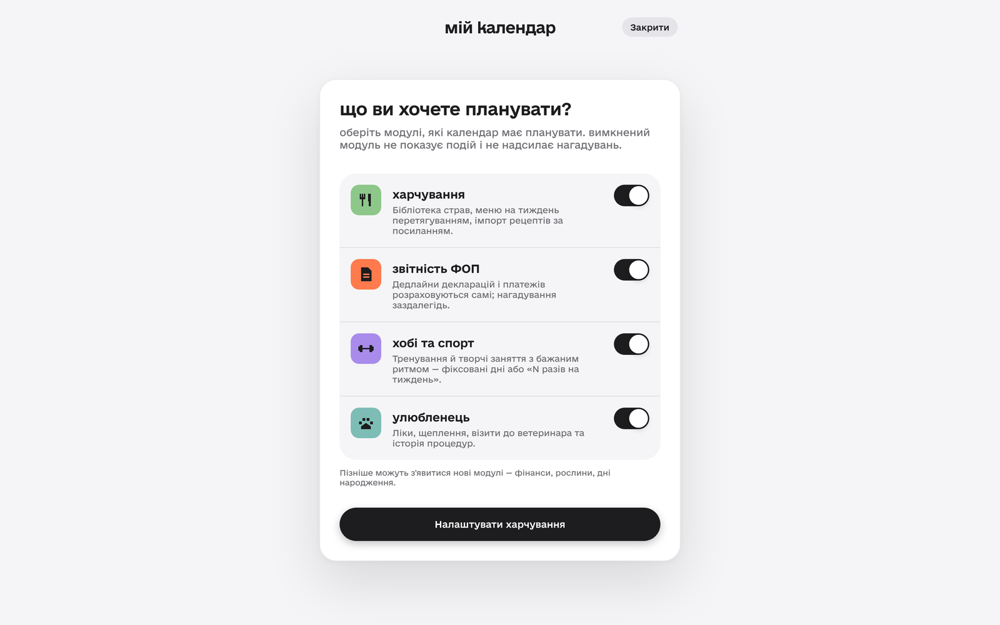
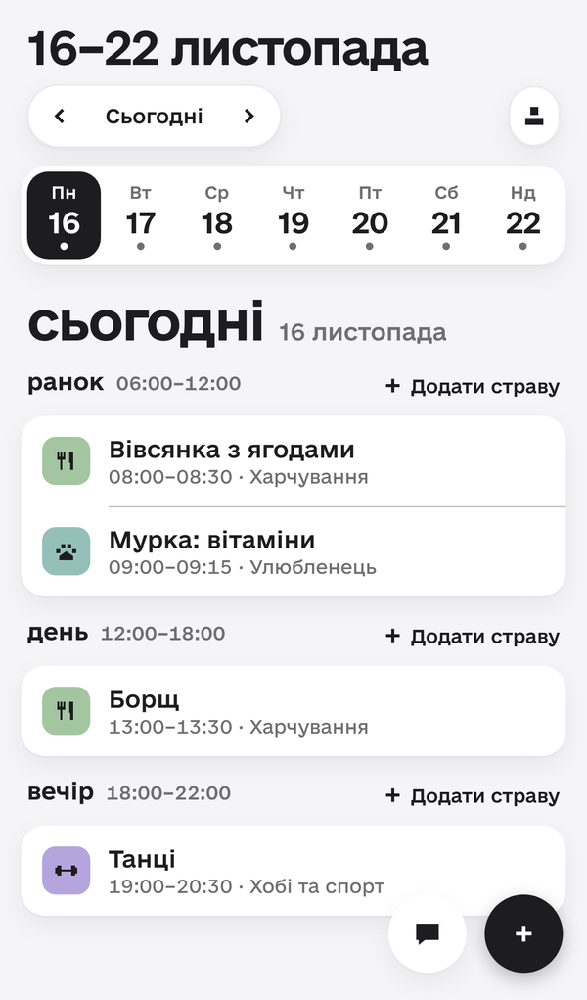
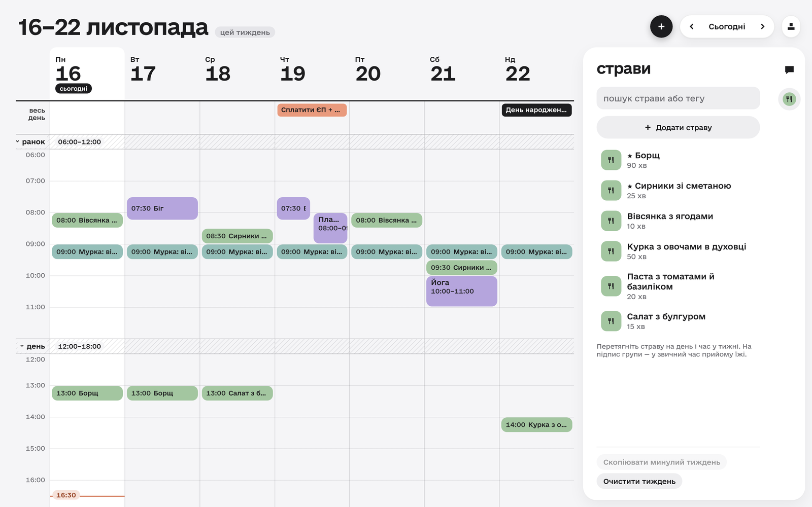

# мій календар — a calendar that plans itself

A personal planning web app (PWA) for meals, sole-proprietor tax deadlines, hobbies and pet care, all in one week view.
I designed it and built it with Claude Code, and I use it myself.

**Live demo:** _link coming soon_ (no sign-in; sample data lives only in your browser)
**Design system:** [мій календар design system](https://claude.ai/artifact/3vBzMkq3jixvQ184BwDobQ)



---

## The problem

My week lived in five places. There was a meal plan in Notes and tax deadlines in a bookmarked government page. The cat's vaccinations were in a paper vet passport, and workouts were in my head.
General-purpose calendars can hold all of it, but someone still has to *type it all in* and remember the rules: when the next single-tax payment is due for group 3, or when the next rabies shot is due.

**Goal:** answer a few questions once, and the calendar fills the coming weeks by itself. After that, adding something takes one short phrase.

## My role

I'm a product designer. I own the problem, the UX/UI, the design system and every product decision.
The code is written by Claude Code under my direction. I review each change on a laptop and a phone before it ships.

- **Timeline:** 4 days, 13–16 Nov 2026, about 85 shipped iterations
- **Stack:** React + TypeScript + Vite, PWA, Supabase (auth, Postgres, realtime), Vercel

## Key decisions

**1. Onboarding that generates the calendar, not a blank grid.**
Each module asks only what it needs. For taxes that's the group, the VAT rate and who you pay; for a pet it's medicines, the last vaccination and the vet visit.
The app then calculates the events. Before anything is created, you see a 7-day preview of what will appear.

| | |
|---|---|
|  |  |

**2. The day is split into morning / day / evening, not just an hour grid.**
People plan meals and habits by part of the day. On the phone, the week becomes a "today" list grouped the same way. Each group has its own "add a dish" action.

**3. An assistant that acts first, with Undo, instead of a confirmation form.**
You type "dance Mon and Wed from 6 to 8" and the events appear right away, with **Undo** under the reply.
The first version deliberately uses a rule-based parser instead of an LLM: it costs nothing, needs no API keys and keeps data private.
The parser returns a typed `Plan`, so an LLM can replace it later without touching the UI. *([decision note](docs/decisions/001-assistant-rules-first.md))*

**4. Meal planning by drag and drop.**
There's a dish library in a side panel, and you drag a dish onto a day and time. Ingredients are extracted from the description automatically, so there are no forms to fill in.



**5. No completion stats, by principle.**
No streaks, counters or progress bars. The calendar helps you plan; it doesn't grade you.

**6. Nothing gets lost offline.**
Every change is shown immediately and queued on the device. It's sent when the connection returns.
The UI has explicit states: "No connection, changes saved on this device" and "The server rejected a change". *([decision note](docs/decisions/002-offline-queue.md))*

## How I work with Claude Code

1. **Write first.** I write a brief and wireframes, then set up a design system with tokens for colour, type scale, spacing and radii.
2. **Small, precise requests.** I send a screenshot plus one instruction, for example "step title 24 bold, 32 to the block, same on every step". Claude Code edits the existing codebase.
3. **Verify like a user.** Every change is built and screenshotted on a 1440 px laptop and an iPhone 13. Then it auto-deploys to Vercel in about a minute, and I test the live app.
4. **Keep the system in sync.** If a token changes in code, the design system and the decision log are updated in the same step.
5. **Decide by using it.** The side panel went through four layouts in one day: always open → collapsible → tabs → icon rail like Google Calendar. I made each decision after using the previous version.

## About this repository

This is a **public demo snapshot** of the app. My production repository is private.

| | Production | This demo |
|---|---|---|
| Sign-in | Google, allow-list | none |
| Data | Supabase Postgres + realtime | your browser's localStorage, seeded with an invented week |
| Recipe import by URL | serverless function | disabled |

The only change from production is the data layer: [`src/lib/supabase.ts`](src/lib/supabase.ts) is replaced by a small in-browser stand-in, and [`src/demo/seed.ts`](src/demo/seed.ts) builds the sample week.
The seed uses the real onboarding generator, so tax deadlines, pet reminders and workouts come from the same logic as in production. To start over, open the account menu and choose **Почати демо заново** ("Start the demo over").

The interface is in Ukrainian, because the product is built for Ukrainian sole proprietors (ФОП).

```bash
npm install
npm run dev
```

## Project map

- `src/onboarding/`: module steps, answers, event generation (`generate.ts`), tax deadline rules (`fop.ts`)
- `src/assistant/`: chat panel and the rule-based phrase parser (`parse.ts`)
- `src/food/`: dish library, dish card, ingredient extraction
- `src/components/`: week view, today view, event dialog
- `src/lib/`: store, offline queue (`outbox.ts`), repeating events, dates
- `src/styles.css`: styles built on the design system tokens

---

Fonts: e-Ukraine / e-UkraineHead (CC BY 4.0). Demo food photos: [Unsplash](https://unsplash.com) (Unsplash License). The tax deadline rules are a planning aid, not accounting advice.
